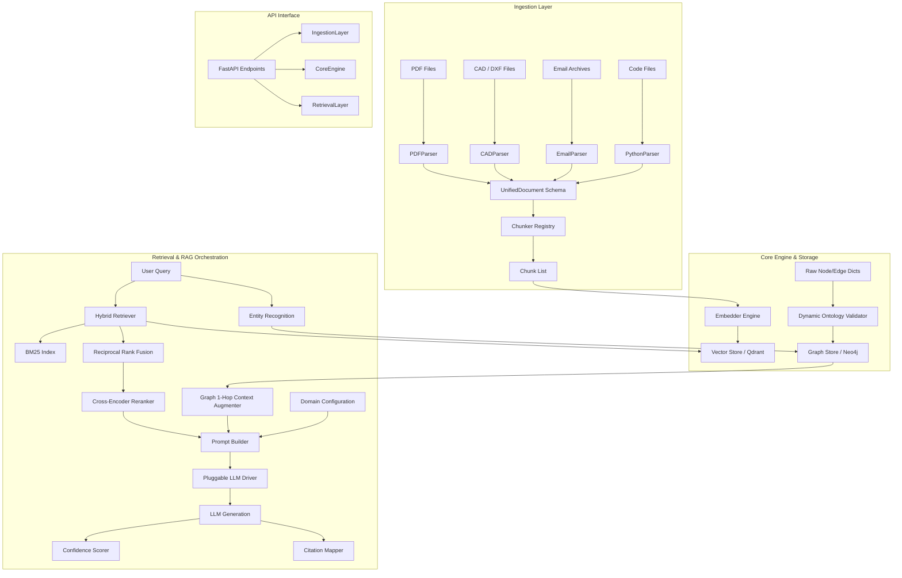
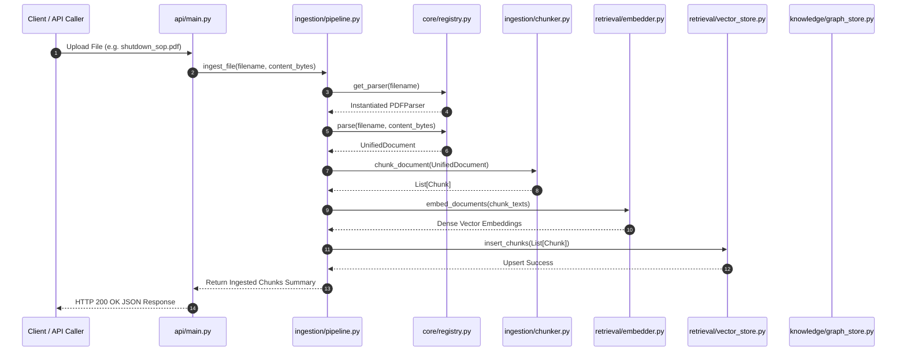
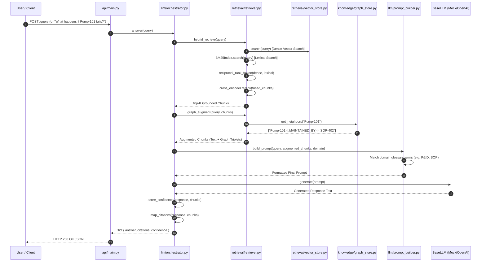

# Institutional Memory — Complete System Knowledge Base & Technical Architecture Guide

---

## 1. Project Overview & Philosophy

**Institutional Memory** is an enterprise-grade, domain-agnostic **Industrial Knowledge Intelligence & Graph RAG Platform**. In complex industrial environments (e.g., chemical refineries, power plants, manufacturing facilities), knowledge is heavily fragmented across heterogeneous data formats:
- **PDF Documents**: Standard Operating Procedures (SOPs), compliance standards, regulatory clauses.
- **CAD/DXF Drawings**: Engineering schematics, block diagrams, equipment layouts.
- **Email Archives & Messages**: Operational logs, maintenance updates, incident reports.
- **Source Code & Scripts**: Automation scripts, telemetry utilities.
- **Knowledge Graphs**: Structured entity-relationship networks (e.g., Equipment maintained by SOPs, incidents caused by equipment failures).

### Core Problem Solved
Traditional Retrieval-Augmented Generation (RAG) systems fail in specialized industrial domains due to:
1. **Format Rigidity**: Difficulty ingesting heterogeneous engineering data formats.
2. **Domain Rigidity**: Prompts and entity models hardcoded for a single domain.
3. **Retrieval Blind Spots**: Dense vector search alone misses exact codes (e.g., `Pump-101`, `SOP-402`) and structural graph relations.
4. **Hallucination Risk**: Unsupported LLM generations without domain glossary context or strict citation verification.

### System Solution Strategy
This platform solves these challenges through:
- **Universal Data Contract**: All inputs are normalized into `UnifiedDocument` and `Chunk` schema objects.
- **Plugin-Based Architecture**: Abstract Base Classes (ABCs) and registry decorators allow adding new parsers, vector engines, embedders, and LLM backends without changing core logic.
- **Config-Driven Domain Engine**: Ontologies, entity/relation types, glossaries, and prompt templates are externalized into `domain.yaml` and dynamic hot-reloadable components.
- **Hybrid Augmented Retrieval**: Combines Dense Vector Search + BM25 Lexical Keyword Search via Reciprocal Rank Fusion (RRF), Cross-Encoder Reranking, and 1-Hop Graph Context Expansion.
- **Grounded Verification**: Automated factual confidence scoring and inline citation mapping.

---

## 2. Architecture & Data Flow Diagrams

### 2.1 System Architecture Overview



---

### 2.2 Data Ingestion Lifecycle



---

### 2.3 Query & Hybrid RAG Retrieval Lifecycle



---

## 3. Comprehensive Folder & File-by-File Breakdown

Below is an exhaustive reference of every directory and file in the codebase, detailing its purpose, implementation mechanics, input/output data contracts, and connectivity.

---

### 3.1 `core/` Directory (Foundational Data Models & Registries)

#### `core/config.py`
- **Why It Exists**: Centralized loader and manager for domain-specific context, entity ontologies, glossary terms, and prompt templates.
- **How It Works**:
  - Defines `GlossaryItem` and `DomainConfig` Pydantic models.
  - `load_domain_config()` locates `config/domain.yaml` via helper `get_project_root()`, safely parses YAML, and falls back to robust default values if parsing fails.
  - Exposes global `DOMAIN` instance.
  - Provides `save_domain_config()` and `reload_domain_config()` to modify and update active configurations at runtime without restarting servers.
- **Inputs**: File path to `domain.yaml` or raw Python dictionaries.
- **Outputs**: Instantiated `DomainConfig` object.
- **Interconnections**: Used by `core/schema.py` for type validation, `llm/prompt_builder.py` for glossary expansion, and `api/main.py` for `/config` endpoints.

#### `core/schema.py`
- **Why It Exists**: Defines standard data contracts (`UnifiedDocument`, `Chunk`, `Node`, `Edge`) across all ingestion, retrieval, and graph operations.
- **How It Works**:
  - `make_doc_id(modality, source_path)`: Creates reproducible SHA-256 string hashes.
  - `UnifiedDocument`: Represents parsed documents regardless of origin (`doc_id`, `modality`, `source_path`, `raw_content`, `metadata`).
  - `Chunk`: Unit of vector retrieval containing text, optional embedding vector, doc reference, and chunk metadata.
  - `Node` & `Edge`: Graph elements. Uses Pydantic `@model_validator(mode="after")` to dynamically validate `type` against `DOMAIN.entity_types` and `DOMAIN.relation_types`.
- **Inputs**: Raw data dicts, strings, and metadata.
- **Outputs**: Validated Pydantic domain models. Raises `ValueError` on schema non-compliance.
- **Interconnections**: Foundation for parsers, chunkers, graph store, vector store, and API schemas.

#### `core/registry.py`
- **Why It Exists**: Decouples the core pipeline logic from specific component implementations (e.g. switching Qdrant with Milvus, or PDFParser with Docling).
- **How It Works**:
  - Implements generic `Registry[T]` class with `register(name)` decorator and `get(name)` lookup.
  - Defines Abstract Base Classes (ABCs): `BaseParser`, `BaseEmbedder`, `BaseVectorStore`, `BaseGraphStore`, `BaseLLM`.
  - Maintains `PARSER_REGISTRY` dict mapping extensions (e.g. `pdf`, `dxf`, `eml`) to parser classes via `@register_parser(*extensions)`.
  - Provides `get_parser(file_path)` helper.
  - Includes default testing mocks: `InMemoryGraphStore` and `MockLLM`.
- **Inputs**: Extension strings, class definitions.
- **Outputs**: Instantiated plugin implementations.
- **Interconnections**: Ingestion pipeline, retriever, and API load components through these registries.

---

### 3.2 `config/` Directory

#### `config/domain.yaml`
- **Why It Exists**: Human-readable YAML configuration file controlling the target industry context.
- **How It Works**: Contains:
  - `domain_name`: Industry title (e.g., "Generic Industrial Plant").
  - `entity_types`: Allowed graph node labels (`Equipment`, `Procedure`, `RegulatoryClause`, `Person`, `Incident`, `Parameter`).
  - `relation_types`: Allowed graph edge labels (`MAINTAINED_BY`, `PART_OF`, `MENTIONED_IN`, `CAUSED_BY`, `SUPERSEDES`).
  - `glossary`: List of domain acronyms/terms and meanings (`P&ID`, `OT`, `SOP`).
  - `system_prompt_template`: Format string for domain guidelines.
- **Interconnections**: Loaded directly by `core/config.py`.

---

### 3.3 `ingestion/` Directory (Data Ingestion & Parsing Pipeline)

#### `ingestion/parsers/__init__.py`
- **Why It Exists**: Module entry point ensuring parser plugins are imported and registered decorator hooks execute.
- **How It Works**: Imports `PDFParser`, `CADParser`, `EmailParser` and exports them via `__all__`.

#### `ingestion/parsers/pdf_parser.py`
- **Why It Exists**: Ingests PDF documents into the `UnifiedDocument` schema.
- **How It Works**: Decorated with `@register_parser("pdf")`. Reads raw bytes, decodes text content (simulated fallback for demonstration), sets modality to `"text"`, generates deterministic `doc_id`.
- **Inputs**: File name, `content_bytes`, optional metadata.
- **Outputs**: `UnifiedDocument` with modality `"text"`.

#### `ingestion/parsers/email_parser.py`
- **Why It Exists**: Parses MIME email archives (`.eml`, `.mbox`, `.msg`).
- **How It Works**: Decorated with `@register_parser("eml", "mbox", "msg")`. Uses standard `email` library with `policy.default` to extract `From`, `To`, `Subject`, `Date` headers and walk message parts to extract plain text body content.
- **Inputs**: Raw byte stream of email file.
- **Outputs**: `UnifiedDocument` with modality `"email"` and header metadata.

#### `ingestion/parsers/cad_parser.py`
- **Why It Exists**: Ingests AutoCAD DXF vector files.
- **How It Works**: Decorated with `@register_parser("dxf")`. If optional library `ezdxf` is available, parses DXF entity modelspace (`TEXT`, `MTEXT`, `INSERT` block references). Otherwise, uses an ASCII fallback scanner reading group code pairs (`1` for text, `2` for block insert names).
- **Inputs**: DXF byte content.
- **Outputs**: `UnifiedDocument` with modality `"cad"` listing layer names and CAD strings.

#### `ingestion/chunker.py`
- **Why It Exists**: Segments raw document text into standardized search `Chunk` units.
- **How It Works**:
  - Maintains `CHUNK_STRATEGY_OVERRIDES` table via `@register_chunk_strategy(modality)`.
  - `@register_chunk_strategy("code")`: Splits source code on double newlines (`\n\n`) to preserve whole function/class definitions.
  - `default_semantic_split()`: Fallback character sliding-window chunker (`chunk_size=500`, `overlap=50`).
  - `chunk_document()`: Routes documents to custom modality strategies or default splitting.
- **Inputs**: `UnifiedDocument`, optional `chunk_size`, `overlap`.
- **Outputs**: `List[Chunk]`.

#### `ingestion/pipeline.py`
- **Why It Exists**: High-level workflow orchestrator managing ingestion execution.
- **How It Works**:
  - `IngestionPipeline` resolves active embedder, vector store, and graph store components from `core.registry`.
  - `ingest_file()`: Resolves parser -> generates `UnifiedDocument` -> produces `Chunk` list -> generates dense embeddings via `self.embedder` -> stores in `self.vector_store`.
  - `ingest_graph_elements()`: Takes raw node and edge dicts, instantiates `Node(**n)` and `Edge(**e)` (triggering ontology validation), and saves valid elements into `self.graph_store`.
- **Inputs**: File byte payloads, filename, graph dicts.
- **Outputs**: List of stored `Chunk` instances; updates stores.

---

### 3.4 `retrieval/` Directory (Hybrid Retrieval & Vector Engine)

#### `retrieval/embedder.py`
- **Why It Exists**: Vector embedding abstraction supporting deterministic simulation and neural models.
- **How It Works**:
  - `get_deterministic_vector(text)`: Converts string text into an MD5 hash seed to generate deterministic, normalized float vectors for consistent unit testing without external APIs.
  - Conditional neural loader: If `USE_NEURAL_MODELS=1`, loads HuggingFace `SentenceTransformer("all-MiniLM-L6-v2")`.
  - `PluggableEmbedder`: Object-oriented adapter wrapping functions for `embedder_registry`.
- **Inputs**: String query or text list.
- **Outputs**: Float list vector (e.g. 1536-dim or model-specific dimension).

#### `retrieval/vector_store.py`
- **Why It Exists**: Vector database storage and similarity search engine.
- **How It Works**:
  - `QdrantMockClient`: In-memory point storage simulating Qdrant DB. Performs cosine similarity via vector dot products.
  - `upsert_chunk(chunk)`: Embeds chunk text and upserts into `QdrantMockClient`.
  - `InMemoryVectorStore`: OO Adapter registered under `vector_store_registry` with `insert_chunks()` and `similarity_search()` with metadata filter evaluation.
- **Inputs**: `Chunk` list, query embedding, metadata filter dict.
- **Outputs**: Top-K matching `Chunk` objects with similarity scores.

#### `retrieval/retriever.py`
- **Why It Exists**: Multi-stage hybrid search and graph augmentation pipeline.
- **How It Works**:
  - `BM25Index`: Tokenizes document collection and computes Okapi BM25 keyword matching scores (using IDF and term frequency weighting).
  - `reciprocal_rank_fusion(vector_hits, keyword_hits, k=60)`: Fuses dense vector search and BM25 search rankings into a merged score list ($RRF\_Score = \sum \frac{1}{k + rank}$).
  - `MockCrossEncoder`: Reranks fused candidates based on token overlap / optional neural cross-encoder transformer (`ms-marco-MiniLM-L-6-v2`).
  - `extract_entity_mentions(query)` & `graph_augment(query, chunks)`: Matches query strings against graph node names and retrieves 1-hop connected triplets from Neo4j/Graph store to inject structural graph context into retrieval output.
  - `hybrid_retrieve(query)`: Executes vector scan + BM25 search -> RRF fusion -> cross-encoder reranking.
- **Inputs**: Search query string, top-k limit.
- **Outputs**: Hybrid-retrieved, graph-augmented `List[Chunk]`.

---

### 3.5 `knowledge/` Directory (Knowledge Graph Management)

#### `knowledge/graph_store.py`
- **Why It Exists**: Entity-relationship graph database driver.
- **How It Works**:
  - `Neo4jSimulationDriver`: Simulates Neo4j Cypher merges (`MERGE (n:Label ...)`, `MERGE (source)-[:REL]->(target)`). Stores nodes and edge dictionaries in memory.
  - `get_neighbors(entity_name)`: Queries 1-hop connected incoming/outgoing relationship edges.
  - Helper functions: `write_entity()`, `write_relation()`, `link_chunk_to_entities()`.
- **Inputs**: `Node`, `Edge`, or generic entity class objects.
- **Outputs**: 1-hop graph relationship strings (e.g. `"Pump-101 -[:MAINTAINED_BY]-> SOP-402"`).

#### `knowledge/ner.py`
- **Why It Exists**: Module placeholder for entity and relation extraction pipelines.

---

### 3.6 `llm/` Directory (Prompt Engineering & RAG Orchestration)

#### `llm/prompt_builder.py`
- **Why It Exists**: Dynamic system and user prompt constructor.
- **How It Works**:
  - `build_system_prompt(domain)`: Formats `domain.system_prompt_template` with `domain_name`.
  - `build_prompt(query, context_chunks, domain)`: Scans combined query and context text against `domain.glossary`. If matching acronyms/terms are found (e.g., `P&ID`), auto-injects a **Domain Glossary Definitions** block into the prompt before context chunks, instructing LLM to format inline citations.
- **Inputs**: User query string, retrieved `Chunk` list, domain configuration.
- **Outputs**: Complete LLM prompt string.

#### `llm/orchestrator.py`
- **Why It Exists**: RAG orchestration engine with confidence scoring and citation mapping.
- **How It Works**:
  - `score_confidence(response, context_chunks)`: Calculates word recall overlap between generated LLM response and context chunks. Returns float between 0.0 and 1.0.
  - `map_citations(response, context_chunks)`: Scans response for explicit `[chunk_id]` tags or key term overlaps, mapping cited chunks back to source document ID, modality, source path, and text snippets.
  - `answer(query)`: Orchestrates `hybrid_retrieve()` -> `graph_augment()` -> `build_prompt()` -> LLM `generate()` -> `score_confidence()` -> `map_citations()`. Rejects low-confidence responses if below `CONFIDENCE_THRESHOLD = 0.5`.
  - `RAGOrchestrator`: Adapter class wrapping `answer()` with optional metadata filtering.
- **Inputs**: Query string, limit, filters.
- **Outputs**: Dictionary containing `answer`, `citations` list, `confidence` score, and `system_prompt`.

---

### 3.7 `api/` Directory (FastAPI REST Services)

#### `api/main.py`
- **Why It Exists**: Web REST API server exposing system functionality over HTTP.
- **How It Works**:
  - Initializes FastAPI app with CORS middleware.
  - Instantiates `IngestionPipeline` and `RAGOrchestrator`.
  - Implements Endpoints:
    - `POST /ingest`: Multipart file upload. Saves to `uploads/`, processes via `ingest_file()`.
    - `POST /ingest-folder`: Recursively scans a local folder path and ingests all matching file formats.
    - `POST /query`: Accepts query parameter, runs `answer(q)`, returns response payload.
    - `GET /config`: Returns active `DOMAIN` configuration JSON.
    - `PUT /config`: Receives new domain YAML dict, updates configuration via `save_domain_config()` & `reload_domain_config()`.
    - Legacy endpoints: `POST /ingest/file`, `POST /ingest/graph`.
- **Inputs**: HTTP multipart files, JSON payloads, URL parameters.
- **Outputs**: JSON HTTP responses.

---

### 3.8 Test & Script Suite

#### `test_step1.py`
- **Purpose**: System integration test.
- **Execution Flow**:
  1. Displays active domain configuration and glossary.
  2. Verifies parser registry state.
  3. Ingests heterogeneous data formats: PDF (`shutdown_sop.pdf`), CAD/DXF (`refinery_layout.dxf`), Email (`incident_report.eml`), Code (`utils.py` with custom double-newline strategy).
  4. Tests ontology schema validation guardrails (submitting invalid node type `UnknownRoleType` and invalid edge type `LOVES` to confirm validation errors).
  5. Executes end-to-end RAG query with automatic glossary matcher.
  6. Demonstrates Knowledge Graph node/edge/chunk writing.

#### `test_step10.py`
- **Purpose**: Focused unit test for LLM orchestration & prompt building.
- **Execution Flow**: Tests system prompt generation, prompt assembly, recall confidence score heuristics, and inline citation mapping.

#### `test_api.py`
- **Purpose**: API endpoint integration test using FastAPI `TestClient`.
- **Execution Flow**: Tests `GET /config`, `PUT /config` dynamic domain hot-reloading, `POST /ingest` file uploading, and `POST /query` chatbot answers.

---

## 4. Problems Addressed & Technical Optimizations

| Problem Encountered | Architectural Solution | Implementation Detail |
| :--- | :--- | :--- |
| **Data Format Fragmentation** (PDF, CAD, Email, Code siloed in separate tools) | **Universal Data Contract & Plugin Registry** | `UnifiedDocument` schema standardizes all formats. `@register_parser` decorator enables zero-code modification when adding new file parsers. |
| **Code Chunking Loss** (Character splitters breaking function syntax) | **Modality-Specific Chunking Strategies** | `@register_chunk_strategy("code")` splits code files on logical `\n\n` delimiters, maintaining whole function contexts. |
| **Dense Vector Keyword Failures** (Vector search failing on precise tags like `Pump-101`) | **Hybrid Retrieval (Dense Vector + BM25 + RRF)** | `hybrid_retrieve` executes both vector similarity and Okapi BM25 keyword searches, combining ranks via Reciprocal Rank Fusion ($k=60$). |
| **Loss of Structural Entity Context** (Vectors ignoring graph connections) | **Graph 1-Hop Neighbor Context Augmentation** | `extract_entity_mentions` finds query entities in Neo4j and injects 1-hop connected triplets into the LLM context. |
| **Domain Instability** (Hardcoded prompt templates and rigid entity models) | **Config-Driven Domain Engine & Dynamic Reloading** | Entity labels (`Node`, `Edge`) validate at runtime against `domain.yaml`. Dynamic `/config` PUT endpoint allows zero-downtime industry switching. |
| **Acronym & Jargon Confusion** | **Automatic Domain Glossary Injector** | `build_prompt` scans queries and context against domain glossary items (`P&ID`, `SOP`, `OT`) and auto-injects definitions directly into the LLM prompt. |
| **LLM Hallucinations & Uncited Claims** | **Confidence Scoring & Citation Mapping** | `score_confidence` evaluates word recall overlap. `map_citations` tracks explicit `[chunk_id]` tags and matches snippets to source files. |
| **Hardware & Dependency Lock-in** | **Decoupled Abstract Base Classes (ABCs)** | Components implement `BaseParser`, `BaseVectorStore`, `BaseGraphStore`, `BaseLLM`, allowing effortless swapping between mock test classes and production backends. |

---

## 5. Execution Guide: How to Run, Why to Run, and Expected Results

### 5.1 Prerequisites & Installation

Ensure Python 3.10+ is installed on your system.

```bash
# Navigate to project root directory
cd /home/r1ddh1/4th_year/projects/institutional-memory

# Install required packages
pip install -r requirements.txt
```

---

### 5.2 Running System Integration Tests (`test_step1.py`)

- **Why Run It**: To verify end-to-end data ingestion across PDF, CAD, Email, and Code files, test domain schema validation rules, run graph writes, and test RAG query generation.
- **Command**:
  ```bash
  python3 test_step1.py
  ```
- **Expected Result**:
  - Displays registered parsers: `['pdf', 'dxf', 'eml', 'mbox', 'msg', 'py']`.
  - Confirms PDF, CAD, Email, and Python code ingestion.
  - Successfully catches and rejects invalid entity types (`UnknownRoleType`) and edge types (`LOVES`) with `Pydantic` `ValueError` messages.
  - Outputs generated RAG answer and citations.
  - Terminal prints `ALL STEP 2 - 6 TESTS COMPLETED SUCCESSFULLY!`.

---

### 5.3 Running Orchestrator & Prompt Tests (`test_step10.py`)

- **Why Run It**: To validate LLM prompt construction, recall confidence scoring math, and citation extraction logic in isolation.
- **Command**:
  ```bash
  python3 test_step10.py
  ```
- **Expected Result**:
  - Prints system prompt preview.
  - Formats complete user prompt with context.
  - Evaluates high match confidence (~0.90) vs low match confidence (~0.10).
  - Terminal prints `ALL STEP 10 FUNCTIONALITY COMPLETED & VERIFIED SUCCESSFULLY!`.

---

### 5.4 Running FastAPI Integration Tests (`test_api.py`)

- **Why Run It**: To test HTTP endpoints in-memory using FastAPI `TestClient` without starting a background server process.
- **Command**:
  ```bash
  python3 test_api.py
  ```
- **Expected Result**:
  - Tests `GET /config` (returns active domain name `Generic Industrial Plant`).
  - Tests `PUT /config` (swaps domain context to `Chemical Refinery Complex V4` and verifies reload).
  - Restores original configuration.
  - Uploads test file via `POST /ingest` and queries via `POST /query`.
  - Terminal prints `ALL API STEP 11 TESTS COMPLETED SUCCESSFULLY!`.

---

### 5.5 Launching the Live FastAPI Web Server

- **Why Run It**: To expose the backend REST API for frontend applications, external systems, or interactive documentation.
- **Command**:
  ```bash
  uvicorn api.main:app --host 0.0.0.0 --port 8000 --reload
  ```
- **Interactive OpenAPI Documentation**:
  Open your web browser and navigate to:
  `http://localhost:8000/docs`

#### Key API Endpoints & Payloads

1. **Ingest Single File**:
   - `POST /ingest`
   - Form field: `file` (Multipart file upload)
   - Response: `{"status": "success", "filename": "shutdown_sop.pdf", "chunks_count": 1}`

2. **Ingest Local System Directory**:
   - `POST /ingest-folder?folder_path=/path/to/documents`
   - Scans directory recursively for supported documents (`.pdf`, `.dxf`, `.eml`, `.py`).

3. **Query Knowledge Base**:
   - `POST /query?q=What is the emergency shutdown procedure for Pump-101?`
   - Response:
     ```json
     {
       "answer": "[Mock LLM Response] Answer to query based on prompt size...",
       "citations": [
         {
           "doc_id": "2c3ac69a...",
           "chunk_index": 0,
           "source_path": "shutdown_sop.pdf",
           "modality": "text",
           "snippet": "SOP-402: Emergency Shutdown Procedure..."
         }
       ],
       "confidence": 0.95
     }
     ```

4. **Get / Update Domain Configuration**:
   - `GET /config`: Returns current domain YAML.
   - `PUT /config`: Accepts updated JSON payload containing `domain_name`, `entity_types`, `relation_types`, and `glossary` to reconfigure the platform instantly at runtime.

---
